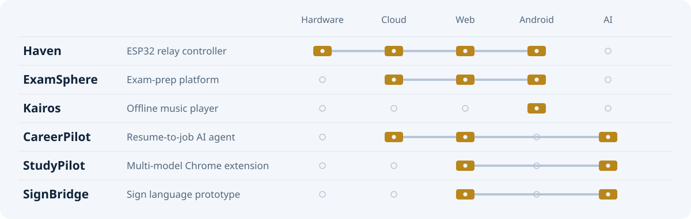

<picture>
  <source media="(prefers-color-scheme: dark)" srcset="./assets/banner-dark.svg" />
  
</picture>

  <a href="https://arifportfolio-swart.vercel.app/">Portfolio</a> &nbsp;/&nbsp;
  <a href="https://arifportfolio-swart.vercel.app/Arif-Hossain-Resume.pdf">Resume</a> &nbsp;/&nbsp;
  <a href="https://linkedin.com/in/skarifhossain-it">LinkedIn</a> &nbsp;/&nbsp;
  <a href="mailto:skarifhossain36@outlook.com">skarifhossain36@outlook.com</a>

Open to Software Developer, Android and IoT roles for 2027.

## What I've built

<picture>
  <source media="(prefers-color-scheme: dark)" srcset="./assets/stack-dark.svg" />
  
</picture>

**[Haven](https://github.com/Arif1221/Web_Dashboard_relay)** controls mains relays from a phone. ESP32 firmware with Bluetooth setup and verified TLS, schedules that keep running offline, and a React + Firebase dashboard with an Android app. Built during my internship at Maxbridge Solutions. [Live dashboard](https://esp32dashboardrelay.vercel.app)

**[ExamSphere](https://examsphere.in)** is a live exam-prep platform. I built the Next.js web app with a server-graded quiz API over 1,800+ GATE questions, and the Jetpack Compose Android app on the same backend. Collaborative project, so the code is private.

**[Kairos](https://github.com/Arif1221/kairos)** is an offline Android music player: time-synced lyrics read straight from file tags, bit-perfect USB audio, and colours taken from the album art. [Download the APK](https://github.com/Arif1221/kairos/releases/latest)

**[CareerPilot](https://github.com/Arif1221/Careerpilot-Agent)** scores a resume against a job description and rewrites the weak bullets (FastAPI + Gemini). [Try it](https://careerpilot-agent.vercel.app)

**[StudyPilot](https://github.com/Arif1221/Multi-Model-Al-Quiz-Assistant)** is a Chrome extension that asks GPT, Claude and Gemini the same question and shows where they agree.

**[SignBridge](https://github.com/Arif1221/SignBridge)** recognises 30 Indian Sign Language signs in the browser with MediaPipe hand tracking.

## What I work with

**Languages:** Java, Python, TypeScript, Kotlin, C, C++ 
**Apps:** React, Next.js, Jetpack Compose, FastAPI, Firebase 
**Hardware:** ESP32, BLE, Arduino, PCB wiring and soldering 
**Shipping:** Git, GitHub Actions, Vitest, pytest, JUnit, Vercel 
**AI dev tools:** Claude Code, Cursor, Google Antigravity, OpenAI Codex

## Activity

<picture>
  <source media="(prefers-color-scheme: dark)" srcset="https://github-readme-stats.vercel.app/api?username=Arif1221&show_icons=true&hide_border=true&include_all_commits=true&count_private=true&hide_rank=true&bg_color=0E1A2B&title_color=EAF0F7&text_color=93A7BF&icon_color=C99A35" />
  
</picture>
<picture>
  <source media="(prefers-color-scheme: dark)" srcset="https://github-readme-stats.vercel.app/api/top-langs/?username=Arif1221&layout=compact&langs_count=8&hide_border=true&bg_color=0E1A2B&title_color=EAF0F7&text_color=93A7BF" />
  
</picture>

<picture>
  <source media="(prefers-color-scheme: dark)" srcset="https://raw.githubusercontent.com/Arif1221/Arif1221/output/github-contribution-grid-snake-dark.svg" />
  
</picture>

On repeat while I code

 

The banner and project map are hand-made SVGs (<code>assets/make_svgs.py</code>), set in Chakra Petch (SIL OFL). The signal on the banner stops for people who prefer reduced motion.
