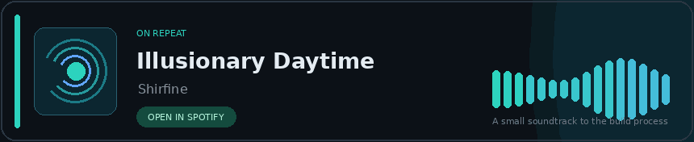

  <h1>SK Arif Hossain</h1>
  
<strong>Software Developer&nbsp; · &nbsp;AI&nbsp; · &nbsp;Full-Stack&nbsp; · &nbsp;IoT</strong>

  
  

    
    
    
    
  

  

    
    
  

---

  <table>
    <tr>
      <td align="center" width="50%">
        
      </td>
      <td align="center" width="50%">
        
      </td>
    </tr>
  </table>

## Tech stack

  

## Selected work

**[ExamSphere](https://arifportfolio-swart.vercel.app/)**  
In development · Web, Android &amp; Admin  
An exam-preparation platform built around courses, topic-wise questions, timed mock tests, and progress tracking.  
Next.js · React · TypeScript · Firebase

**[CareerPilot AI Agent](https://github.com/Arif1221/Careerpilot-Agent)**  
Team project · IBM SkillsBuild  
A resume-to-job analysis workflow that identifies gaps, generates targeted improvements, and reviews its own suggestions.  
Python · FastAPI · React · Gemini

**[StudyPilot AI](https://github.com/Arif1221/Multi-Model-Al-Quiz-Assistant)**  
Multi-model Chrome study assistant  
Compares answers from multiple AI models and presents a consensus with reliability signals to help users verify responses.  
React · TypeScript · Manifest V3 · OpenRouter

**[SignBridge](https://github.com/Arif1221/SignBridge)**  
Experimental Indian Sign Language prototype  
Explores two-way interaction between Indian Sign Language and spoken language. Recognition is currently limited to isolated signs.  
React · TypeScript · MediaPipe · Vite

**[MAKAUT Ledger](https://github.com/Arif1221/Makaut-Calc-by-Lazy-BX)** and **[Salary Predictor AI](https://github.com/Arif1221/salary-predictor-ai)**  
Academic calculation utility and an XGBoost-based salary estimation web app.

## On repeat

  

---

  More about my projects, experience, and current work: <a href="https://arifportfolio-swart.vercel.app/">arifportfolio-swart.vercel.app</a>

