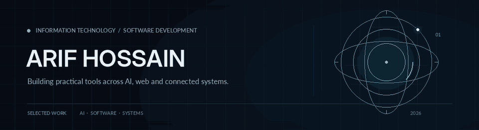

  

  <a href="https://github.com/Arif1221">GitHub</a> &nbsp;·&nbsp;
  <a href="https://github.com/Arif1221?tab=repositories">Repositories</a>

I'm Arif, an Information Technology student interested in building useful software and understanding the systems behind it. Most of my work sits around AI-powered tools, web applications, and computer-vision experiments. I enjoy taking an idea from a rough prototype to something structured, testable, and usable.

## Selected work

| Project | What it does |
|---|---|
| **[StudyPilot AI](https://github.com/Arif1221/Multi-Model-Al-Quiz-Assistant)** | A Chrome side-panel study assistant that detects quiz-style questions, compares responses from multiple AI models, and presents consensus and reliability signals. |
| **[SignBridge](https://github.com/Arif1221/SignBridge)** | An experimental browser prototype for Indian Sign Language and voice interaction. Recognition currently focuses on a limited set of isolated signs, not continuous translation. |
| **[CareerPilot Agent](https://github.com/Arif1221/Careerpilot-Agent)** | A resume-to-job-description workflow: parse requirements, score keyword alignment, generate suggestions, and review the result. |
| **[MAKAUT Ledger](https://github.com/Arif1221/Makaut-Calc-by-Lazy-BX)** | A lightweight, browser-based academic calculator for SGPA, CGPA, YGPA, DGPA, and related conversions. |

## Areas I work in

- **Languages:** Python, TypeScript, JavaScript
- **Application development:** React, FastAPI, Flask, Chrome Extension APIs
- **AI and computer vision:** multi-model API integration, MediaPipe, scikit-learn
- **Tools:** Git, Vite, Tailwind CSS

These are technologies I've used in projects; I'm continuing to deepen my understanding through hands-on work.

## GitHub activity

  

---

Learning through building. Improving through iteration.

